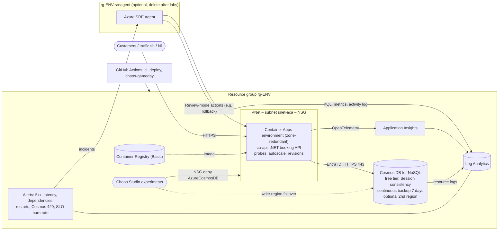

# Azure SRE Learning Lab — Summit Coaching

A hands-on tutorial for learning **Site Reliability Engineering (SRE)** on Azure end to end, using a
small but realistic workload: **Summit Coaching**, a fictional business that sells 1-on-1 coaching
calls, group calls, business presentations and workshops.

You will deploy a containerized .NET API on **Azure Container Apps** backed by **Azure Cosmos DB**, define
**SLOs**, wire up **alerts**, break things on purpose with **Azure Chaos Studio**, and let **Azure SRE Agent**
investigate and mitigate the incidents — while tracking every step against the
[Azure Well-Architected Framework (WAF) reliability pillar](https://learn.microsoft.com/azure/well-architected/reliability/principles).

Everything is parameterized: **fork the repo, run `azd up` in your own subscription**, and tear it down
when you are done. The default configuration costs a few dollars a month (see [Cost](#cost-and-guardrails)).

```
infra/   Bicep (subscription scope): workload + optional SRE Agent + chaos experiments + alerts
src/     .NET 10 minimal API (booking service) + unit tests + Dockerfile
data/    Cosmos DB schema, seed data, saved queries, seed/query/repair scripts
scripts/ lab tooling: traffic generator, fault injection, chaos runner, SLO report, rollback, game day
docs/    runbooks, KQL library, postmortem template, SRE Agent knowledge + custom agent
tests/   k6 load test with SLOs as thresholds
.github/ CI, CD (azd + OIDC), chaos game-day workflow
```

---

## Contents

- [Part 1 — SRE in 15 minutes](#part-1--sre-in-15-minutes)
- [Part 2 — The system](#part-2--the-system)
- [Part 3 — Get it running](#part-3--get-it-running)
- [Part 4 — Labs](#part-4--labs)
  - [Lab 1 — Deploy, seed and explore](#lab-1--deploy-seed-and-explore)
  - [Lab 2 — Critical flows, SLIs, SLOs and error budgets](#lab-2--critical-flows-slis-slos-and-error-budgets)
  - [Lab 3 — Observability and alerting](#lab-3--observability-and-alerting)
  - [Lab 4 — Failure mode analysis](#lab-4--failure-mode-analysis)
  - [Lab 5 — Chaos: Cosmos DB network blackout](#lab-5--chaos-cosmos-db-network-blackout)
  - [Lab 6 — Redundancy: multi-region Cosmos DB failover](#lab-6--redundancy-multi-region-cosmos-db-failover)
  - [Lab 7 — Azure SRE Agent: incident response with an AI teammate](#lab-7--azure-sre-agent-incident-response-with-an-ai-teammate)
  - [Lab 8 — Safe deployments and scaling](#lab-8--safe-deployments-and-scaling)
  - [Lab 9 — Disaster recovery: point-in-time restore drill](#lab-9--disaster-recovery-point-in-time-restore-drill)
  - [Lab 10 — Game days, postmortems and continuous validation](#lab-10--game-days-postmortems-and-continuous-validation)
  - [Optional — Chaos Studio Workspaces (preview)](#optional--chaos-studio-workspaces-preview)
- [Part 5 — Reference](#part-5--reference)

---

## Part 1 — SRE in 15 minutes

SRE is what happens when you treat operations as a software problem. Its core idea: **reliability is a
feature with a target, not an absolute** — 100% is the wrong goal because it is infinitely expensive and
users cannot tell 99.99% from 100%. You pick a target, measure against it, and spend the difference
(the *error budget*) on shipping features.

### Vocabulary

| Term | Meaning | In this repo |
|---|---|---|
| **SLI** (indicator) | A measurement of user experience, as a ratio of good events / valid events | % of `/api` requests that did not return 5xx; % faster than a threshold |
| **SLO** (objective) | Target for an SLI over a window | 99.5% availability over 28 days, p95 < 300 ms for browsing |
| **SLA** (agreement) | A contractual promise, with penalties. Always looser than the SLO | Azure's SLAs for Container Apps / Cosmos DB bound what you can promise |
| **Error budget** | `1 − SLO`. The unreliability you are *allowed* | 0.5% of requests ≈ 3 h 21 min of full outage per 28 days |
| **Burn rate** | How fast you consume the budget. 1× = exactly on budget | Alert at 14.4× over 1 h (budget gone in ~2 days) |
| **MTTD / MTTR** | Mean time to detect / to recover (mitigate) | Measured in every lab and in the game-day report |
| **RTO / RPO** | Max tolerated downtime / max tolerated data loss for a disaster | Measured in Lab 6 and Lab 9 |
| **Toil** | Manual, repetitive, automatable operational work | Scripts, CI/CD, SRE Agent scheduled tasks remove it |
| **Blast radius** | How much breaks when one thing breaks | Minimized with caching, circuit breakers, least-privilege chaos identities |
| **Steady state / hypothesis** | Chaos engineering: define "normal", predict behavior under a fault, then test | Every chaos lab starts with a written hypothesis |

### What an SRE is responsible for (and where you practice it)

| Responsibility | What it means | Lab |
|---|---|---|
| Define reliability targets | Agree SLOs per *critical user flow* with the business | 2 |
| Observability | Metrics, logs, traces that answer *why*, not just *what* | 3 |
| Alerting | Page on **symptoms** that hurt users (burn rate), not on every cause | 3 |
| Failure mode analysis | Know how each dependency fails and what the user sees | 4 |
| Resilience engineering | Timeouts, circuit breakers, graceful degradation, idempotency | 5 |
| Redundancy & DR | Zones, regions, backups, restore drills — with measured RTO/RPO | 6, 9 |
| Incident response | Detect → triage → **mitigate first** → root cause → postmortem | 7 |
| Safe change management | Health probes, progressive/safe rollout, fast rollback | 8 |
| Chaos engineering & game days | Prove the design works, continuously | 5, 6, 10 |
| Toil reduction / automation | Automate the runbook; let an agent do the legwork, humans decide | 7, 10 |
| Cost awareness | Reliability is a trade-off against money and complexity | Throughout |

### Azure's shared responsibility for reliability

Microsoft is responsible for the platform (datacenters, availability zones, regions, each service's SLA);
**you** are responsible for the workload design, configuration, testing and operations. Turning on a
feature (zone redundancy, a second region) is not the same as being reliable — you must verify it
under failure. That is what this lab does. See [Reliability in Azure](https://learn.microsoft.com/azure/reliability/overview).

### Azure ↔ Google Cloud cheat sheet

SRE was born at Google, and the concepts transfer directly. If you also work with GCP:

| Capability | Azure (this repo) | Google Cloud analogue |
|---|---|---|
| Serverless containers | Azure Container Apps | Cloud Run |
| Globally distributed NoSQL | Azure Cosmos DB for NoSQL | Firestore (Spanner for relational) |
| Container registry | Azure Container Registry | Artifact Registry |
| Traces / APM | Application Insights (OpenTelemetry) | Cloud Trace |
| Logs + query language | Log Analytics (KQL) | Cloud Logging / Log Analytics (SQL) |
| Metrics + alerting | Azure Monitor alerts | Cloud Monitoring alerting policies |
| SLO objects | KQL + scheduled burn-rate alert (built here) | Cloud Monitoring SLOs with burn-rate alerts (native) |
| Fault injection | Azure Chaos Studio | No first-party equivalent (third-party tools) |
| AI operations assistant | Azure SRE Agent | Gemini Cloud Assist investigations |
| IaC / dev CLI | Bicep + Azure Developer CLI | Terraform / Infrastructure Manager + gcloud |
| Workload identity | Managed identity + Azure RBAC | Service accounts + IAM |

---

## Part 2 — The system

### Architecture



### The API

| Endpoint | Critical flow | Behavior when Cosmos DB fails |
|---|---|---|
| `GET /api/offerings` | Browse offerings | Serves the **cached catalog**, header `X-Data-Stale: true` (graceful degradation) |
| `POST /api/bookings` | **Create booking** (revenue) | **Fails fast**: `503` + `Retry-After` in ≤ 3 s. Idempotent via `Idempotency-Key` header |
| `GET /api/customers/{id}/bookings` | View my bookings | `503` + `Retry-After` |
| `/healthz/live`, `/healthz/ready` | Probes | Unaffected (by design — see Lab 5) |
| `/healthz/deps` | Diagnostics | Reports Cosmos DB unhealthy |

Reliability patterns in the code (read these files — they are short and heavily commented):

| Pattern | Where |
|---|---|
| Managed identity, no secrets | `src/Coaching.Api/Data/CosmosClientFactory.cs`, `infra/modules/cosmos.bicep` |
| Timeouts + circuit breaker (Polly) | `src/Coaching.Api/Resilience/DependencyResilience.cs` |
| Graceful degradation (stale cache) | `src/Coaching.Api/Data/OfferingCatalog.cs` |
| Fail fast with 503 + Retry-After | `src/Coaching.Api/Endpoints/ApiEndpoints.cs` |
| Idempotent writes | `src/Coaching.Api/Data/BookingStore.cs` |
| Separate liveness / readiness / dependency health | `src/Coaching.Api/Program.cs`, `infra/modules/containerapps.bicep` |
| Business metrics (bookings created / rejected) | `src/Coaching.Api/Telemetry/AppMetrics.cs` |
| Fault injection for "bad release" drills | `src/Coaching.Api/Chaos/FaultInjection.cs` |

### Well-Architected Framework mapping

**Reliability design principles → this repo**

| WAF principle | How it shows up here |
|---|---|
| Design for business requirements | Critical flows and SLOs agreed per flow (Lab 2), not a vague "always up" |
| Design for resilience | Cache + circuit breaker + 503s, zone-redundant compute, probes (Labs 5, 8) |
| Design for recovery | Continuous backup + restore drill with measured RTO/RPO (Lab 9); rollback (Lab 7) |
| Design for operations | OpenTelemetry, KQL library, burn-rate alerts, runbooks, SRE Agent, game days (Labs 3, 7, 10) |
| Keep it simple | One API, one database, platform features first (Container Apps revisions, Cosmos DB failover) |

**Reliability checklist**

| Code | Recommendation | Where |
|---|---|---|
| RE:01 | Simplicity and efficiency | Minimal components; PaaS; cost guardrails |
| RE:02 | Identify and rate user and system flows | Lab 2 flow table |
| RE:03 | Failure mode analysis | Lab 4 FMA table |
| RE:04 | Reliability and recovery targets | SLOs (Lab 2), RTO/RPO (Labs 6, 9) |
| RE:05 | Redundancy | Zone-redundant Container Apps env; `minReplicas`; optional 2nd Cosmos DB region |
| RE:06 | Scaling strategy | HTTP concurrency autoscaling; shared RU/s (Lab 8) |
| RE:07 | Self-preservation and self-healing | Probes, circuit breaker, timeouts, stale cache, idempotency |
| RE:08 | Chaos engineering | Chaos Studio experiments + app-level faults (Labs 5–8, 10) |
| RE:09 | Disaster recovery | PITR restore drill + repair script (Lab 9) |
| RE:10 | Health monitoring | App Insights, alerts, SLO report, SRE Agent (Labs 3, 7) |

The other pillars are touched too: **Security** (managed identity, `disableLocalAuth`, ACR admin off, least-privilege chaos identities, OIDC in CI),
**Cost** (free tier, scale to zero, log cap, agent in its own RG), **Operational excellence** (IaC, CI/CD, runbooks), **Performance** (autoscaling, partition design, indexing).

---

## Part 3 — Get it running

### Prerequisites

- An Azure subscription where you are **Owner** (or Contributor + User Access Administrator — the Bicep creates role assignments).
- Tools: [Azure CLI](https://learn.microsoft.com/cli/azure/install-azure-cli) 2.60+, [Azure Developer CLI (azd)](https://learn.microsoft.com/azure/developer/azure-developer-cli/install-azd), Python 3.10+, `bash` and `curl`.
  - Easiest: open the repo in **GitHub Codespaces** or VS Code **Dev Containers** (`.devcontainer/` installs everything), or use **Azure Cloud Shell**. On Windows use WSL or Git Bash for the scripts.
  - No Docker needed: images are built in Azure Container Registry.
  - Optional: [k6](https://grafana.com/docs/k6/latest/set-up/install-k6/) for Lab 8; .NET 10 SDK only if you want to run the API locally.

Register the resource providers once per subscription:

```bash
for p in Microsoft.App Microsoft.DocumentDB Microsoft.ContainerRegistry Microsoft.OperationalInsights \
         Microsoft.Insights Microsoft.AlertsManagement Microsoft.Chaos Microsoft.Network Microsoft.ManagedIdentity; do
  az provider register --namespace "$p" --wait
done
```

### Fork, configure, deploy

```bash
git clone https://github.com/<you>/azure-sre-poc.git && cd azure-sre-poc
az login && azd auth login

azd env new sre-lab                      # environment name -> resource group rg-sre-lab
azd env set AZURE_LOCATION eastus2       # any region with Container Apps + Cosmos DB + Chaos Studio
azd env set ALERT_EMAIL you@example.com  # optional

azd up                                   # provision + build in ACR + deploy (~10 min)
azd provision                            # second pass: turns on health probes now that the real image exists
```

Why two commands the first time? Before the first deploy there is no image, so Bicep starts a placeholder
container without probes. `azd deploy` only swaps the image; the next `azd provision` reads the running
image (`SERVICE_API_RESOURCE_EXISTS`) and applies the full configuration. From now on, `azd provision` and
`azd deploy` are safe to run in any order — also from CI.

### Parameters (all optional)

Set with `azd env set NAME value`, then `azd provision`.

| Variable | Default | What it does |
|---|---|---|
| `AZURE_LOCATION` | — | Primary region |
| `MIN_REPLICAS` / `MAX_REPLICAS` | `0` / `3` | Scale to zero when idle. **Use `MIN_REPLICAS=2` during labs** |
| `ACA_ZONE_REDUNDANT` | `true` | Zone-redundant Container Apps environment (no extra cost; region must have zones; fixed at creation) |
| `COSMOS_FREE_TIER` | `true` | One free-tier account per subscription — set `false` if already used |
| `COSMOS_SECONDARY_LOCATION` | *(empty)* | e.g. `centralus`. Adds a read region + enables the failover experiment |
| `COSMOS_THROUGHPUT` | `400` | Shared RU/s per region |
| `ALERT_EMAIL` | *(empty)* | E-mail for alert notifications |
| `LOG_DAILY_CAP_GB` | `0.5` | Log Analytics daily ingestion cap |
| `ENABLE_BURN_RATE_ALERT` | `true` | SLO burn-rate log alert |
| `DEPLOY_CHAOS` / `CHAOS_LOCATION` / `CHAOS_FAULT_DURATION` | `true` / primary / `PT10M` | Chaos Studio experiments |
| `DEPLOY_SRE_AGENT` | `false` | Deploy Azure SRE Agent (see Lab 7 — **billed per hour while it exists**) |
| `SRE_AGENT_LOCATION` | `eastus2` | One of the SRE Agent regions |
| `SRE_AGENT_ACCESS_LEVEL` / `SRE_AGENT_ACTION_MODE` | `High` / `Review` | Can mitigate, but every write needs your approval |
| `SRE_AGENT_MONTHLY_AAU_LIMIT` | `500` | Cap on active-flow Azure Agent Units per month (minimum 500) |

### Cost and guardrails

Idle cost with defaults is roughly **USD 5–8/month**, mostly the container registry and log ingestion.
Check current prices in the [Azure pricing calculator](https://azure.microsoft.com/pricing/calculator/).

| Resource | Cost driver | Guardrail in this repo |
|---|---|---|
| Container Apps (Consumption) | vCPU-s / GiB-s / requests beyond the monthly free grant | `minReplicas = 0`, 0.25 vCPU / 0.5 GiB |
| Cosmos DB | RU/s × regions + storage | Free tier (1000 RU/s, 25 GB): 1 or 2 regions × 400 RU/s = **$0**. Without free tier ≈ $23/month per 400 RU/s region |
| Container Registry | Basic SKU ≈ $5/month | — |
| Log Analytics / App Insights | GB ingested (first 5 GB/month per billing account free) | 0.5 GB daily cap, 30-day retention |
| Alerts | Per metric time series / per log rule | 5 metric alerts + one 15-minute log alert (a few dollars at most) |
| Chaos Studio | Per action-minute while a fault runs | Each experiment = 1 action × 10 minutes; run on demand |
| **Azure SRE Agent** | **4 AAU per hour for as long as the agent exists** + active-flow AAUs | Off by default; own resource group; `scripts/sre-agent.sh down`; 500 AAU active cap; [30-day evaluation waives the always-on charge](https://learn.microsoft.com/azure/sre-agent/evaluate) |
| Lab 9 restored Cosmos DB account | Normal (non-free) RU/s until deleted | Delete it at the end of the lab |

> **Stopping an SRE Agent does not stop its always-on billing — only deleting it does.**
> Clean up everything with `./scripts/sre-agent.sh down` and `azd down --purge --force`.

---

## Part 4 — Labs

Load the environment into your shell once per terminal (the scripts do this themselves):

```bash
set -a; eval "$(azd env get-values)"; set +a
```

Each lab lists the **WAF** items it exercises. Write your observations down — they feed the postmortem in Lab 10.

### Lab 1 — Deploy, seed and explore

*RE:01 · Goal: a working baseline and a mental model of the data.*

1. Seed the database and run the smoke test:
   ```bash
   pip install -r data/requirements.txt
   python data/seed.py
   ./scripts/smoke-test.sh
   ```
2. Call the API yourself:
   ```bash
   curl -s "$SERVICE_API_URI/api/offerings" | python -m json.tool | head -30
   curl -s -i -X POST "$SERVICE_API_URI/api/bookings" -H 'Content-Type: application/json' \
     -H 'Idempotency-Key: my-first-booking' \
     -d '{"offeringId":"group-circle-90","customerId":"cust-me","customerEmail":"me@example.com","startTimeUtc":"2027-01-10T15:00:00+00:00","attendees":3}'
   ```
   Send the same POST again: you get `200` with the *same* booking, not a duplicate. That is idempotency — it
   makes client retries safe, which matters a lot in Lab 5.
3. Explore the data model and RU costs (`data/README.md` explains the partition keys):
   ```bash
   python data/query.py bookings-by-customer --param customerId=cust-ana --partition cust-ana
   python data/query.py find-booking-by-id --param id=seed-0003     # no partition key: fan-out
   ```
   Compare the RU charges. **Question:** during an incident, why is the second query a bad habit at scale?

### Lab 2 — Critical flows, SLIs, SLOs and error budgets

*RE:02, RE:04 · Goal: agree on what "reliable" means before measuring anything.*

**Critical flows (RE:02)**

| Flow | Business impact if broken | Criticality | Can it degrade? |
|---|---|---|---|
| Create booking | Direct revenue loss, customer trust | **High** | No – must be correct or fail clearly |
| Browse offerings | Customers can't choose; indirect revenue | High | Yes – stale catalog is acceptable for a while |
| View my bookings | Support calls, anxiety | Medium | Fail clearly, retry later |

**SLOs (RE:04)** — 28-day rolling window

| Flow | Availability SLI (good = status < 500) | Latency SLI (good = faster than) |
|---|---|---|
| Browse offerings | 99.5% | 95% under 300 ms |
| Create booking | 99.5% | 95% under 800 ms |
| View my bookings | 99.5% | 95% under 500 ms |

**Error budget:** 99.5% → 0.5% of requests may fail. At 100,000 requests / 28 days that is 500 failed requests,
or ~3 h 21 min of total outage. **Error budget policy** (write it down, SRE teams live by it):
*if the budget is exhausted, pause feature releases and spend the next sprint on reliability work.*

**Burn-rate alerting:** burn rate = observed error rate / (1 − SLO). The alert in `infra/modules/alerts.bicep`
fires when the last hour burned ≥ 14.4× — i.e. 2% of a 30-day budget in one hour. That is a page-worthy
signal that still ignores a handful of random errors.

Do it:

```bash
./scripts/traffic.sh 300 3          # 5 minutes of synthetic traffic (keep it running in a second terminal)
./scripts/slo-report.sh 1           # wait ~5 minutes for ingestion first
```

Open `docs/kql/*.kql` in **Log Analytics** (portal → your workspace → Logs) and run them there too.
**Questions:** Why do 4xx responses not burn the budget? Why do we measure per flow instead of one number?
What does `traffic.sh` (client-side) see that Application Insights (server-side) cannot?

### Lab 3 — Observability and alerting

*RE:10 · Goal: be able to answer "what is broken, for whom, since when, and why?"*

1. With `traffic.sh` running, open Application Insights (`APPLICATIONINSIGHTS_NAME`): **Application map**
   (API → Cosmos DB dependency), **Failures**, **Performance**, **Live metrics**.
2. Note the telemetry dimensions you will rely on during incidents: `AppRoleName = coaching-api`,
   `AppVersion` = Container Apps **revision** (so every error is attributable to a release).
3. Review the alerts: `az monitor metrics alert list -g $AZURE_RESOURCE_GROUP -o table` and
   `az monitor scheduled-query list -g $AZURE_RESOURCE_GROUP -o table`.

| Alert | Type | Sev | Symptom or cause? |
|---|---|---|---|
| SLO fast burn | Log (KQL, 15 min) | 1 | **Symptom** – users are hurting at a rate that matters |
| API 5xx | Metric | 2 | Symptom |
| Dependency failures | Metric | 2 | Cause |
| Container restarts | Metric | 2 | Cause |
| API latency | Metric | 3 | Symptom |
| Cosmos DB 429 | Metric | 3 | Cause |

SRE rule of thumb: **page on symptoms, use causes for diagnosis.** Every one of these also becomes an
incident for SRE Agent in Lab 7, where the severity decides whether the agent responds.

### Lab 4 — Failure mode analysis

*RE:03 · Goal: predict how the system fails before you test it.*

| Component | Failure mode | Detection | Mitigation designed in | Residual risk | Tested in |
|---|---|---|---|---|---|
| API replica | Crash / hang | Liveness probe, restart alert | Probes, ≥ 2 replicas during labs, zone-redundant env | Cold start when `minReplicas=0` | Lab 8 |
| API release | Errors or latency after deploy | 5xx / latency / burn-rate alerts | Revisions + rollback | Needs detection first | Lab 7 |
| API release | New revision can't start | Restart alert, revision health | Single-revision mode keeps the old one serving | — | Lab 8 |
| Network path to Cosmos DB | Blocked (NSG, DNS, firewall) | Dependency alert, `/healthz/deps` | Timeouts, circuit breaker, stale cache, 503 + Retry-After, idempotency | Bookings unavailable during outage | Lab 5 |
| Cosmos DB region | Regional outage | Dependency alert, Service Health | 2nd region + service-managed failover | Compute is still single-region | Lab 6 |
| Cosmos DB capacity | Throttling (429) | 429 alert | SDK retries (capped), fail fast | Needs RU increase | Lab 8 (k6) |
| Data | Accidental delete / corruption | Business check (`revenue-by-category`) | Continuous backup (PITR) + repair script | RTO measured in tens of minutes | Lab 9 |
| Availability zone | Zone down | Platform | Zone-redundant Container Apps env | Cosmos DB zone redundancy off (cost) | Discussion |
| Azure region (compute) | Region down | Service Health | **None** – accepted risk for cost | Full outage | Discussion: 2nd region + Front Door |
| Telemetry | Daily cap reached | Workspace "cap reached" event | — | **You go blind** – cost vs observability trade-off | Discussion |

Add a column "**User sees…**" for each row and discuss it — that is the part business stakeholders care about.

### Lab 5 — Chaos: Cosmos DB network blackout

*RE:07, RE:08 · Goal: prove the degradation design works when the database is unreachable.*

**How the fault works.** Container Apps has no native Chaos Studio fault, so we fault its dependency path:
the experiment `exp-cosmos-blackout-*` adds an **outbound DENY rule for the `AzureCosmosDB` service tag** to the
NSG on the Container Apps subnet for 10 minutes, then removes it. The experiment's managed identity has
*Network Contributor* on that one NSG only — that is your blast-radius control.

**Steady state:** availability ≈ 100% for all flows, p95 within SLO.

**Hypothesis** (write yours before running!):
- Within ~60 s of the fault, `POST /api/bookings` returns **503 in < 3 s** (not hanging for 30 s).
- The circuit breaker opens, after which 503s are instant.
- `GET /api/offerings` keeps returning **200** with `X-Data-Stale: true`.
- No duplicate or partial bookings are created.
- Dependency-failure and 5xx alerts fire within 5 minutes; the burn-rate alert within ~15–30 minutes.
- Within ~1 minute after the fault ends, everything recovers **without human action**.

**Run it**

```bash
azd env set MIN_REPLICAS 2 && azd provision     # redundancy for the labs
./scripts/gameday.sh blackout                     # baseline 2 min -> fault 10 min -> recovery 3 min -> report
```

Or manually in two terminals: `./scripts/traffic.sh 900 3` and `./scripts/chaos.sh start blackout`.
While it runs:

```bash
curl -s -i "$SERVICE_API_URI/api/offerings" | grep -i -E "HTTP/|x-data-stale|x-revision"
curl -s "$SERVICE_API_URI/healthz/deps"
az network nsg rule list -g $AZURE_RESOURCE_GROUP --nsg-name $NSG_NAME -o table
```

Then run `docs/kql/circuit-breaker.kql`, `dependency-failures.kql` and `cosmos-data-plane.kql`.

**What to look for / discuss**
- NSG rules only affect *new* connections; the API recycles its Cosmos DB connections every 60 s
  (`PooledConnectionLifetime` in `CosmosClientFactory.cs`). Without that, would the experiment have "done nothing"?
  (A chaos experiment that silently doesn't inject is a classic trap — always verify the fault landed.)
- `cosmos-data-plane.kql` shows Cosmos DB received **no** traffic during the fault: the database was healthy;
  the *path* was broken. Remember this in Lab 7 when an agent (or a human) jumps to "Cosmos DB is down".
- **Thought experiment (or try it):** tag the Cosmos DB health check with `"ready"` in `Program.cs`, redeploy and
  rerun. Every replica fails readiness, Container Apps stops routing, and browsing — which *could* have worked —
  now fails too. Readiness must reflect *this replica*, not shared dependencies.
- How much error budget did 10 minutes cost? (`./scripts/slo-report.sh 1`)

### Lab 6 — Redundancy: multi-region Cosmos DB failover

*RE:05, RE:09 · Goal: measure RTO/RPO of a regional database failover.*

```bash
azd env set COSMOS_SECONDARY_LOCATION centralus   # pick a region paired/near your primary
azd provision                                     # adding a region takes a while; still inside the free tier
```

This also creates `exp-cosmos-failover-*` (Chaos Studio *Cosmos DB Failover* fault: promotes the secondary
to write region for 10 minutes, then fails back) and sets `COSMOS_PREFERRED_REGIONS` on the app.

**Hypothesis:** writes fail for at most a few seconds during the switch, then succeed against the new write
region without a redeploy; reads continue throughout; no acknowledged booking is lost.

```bash
T0=$(date -u +%Y-%m-%dT%H:%M:%S+00:00)
./scripts/gameday.sh failover
python data/query.py bookings-created-since --param sinceUtc=$T0    # compare with 201s in the traffic CSV
```

- **RTO:** from the timeline, first minute with 5xx → first clean minute.
- **RPO:** count `201 Created` responses in the CSV during the window and compare with the query result.
- Portal: Cosmos DB → *Replicate data globally* shows the write region moving and moving back.

**Discuss:** A *planned* failover is graceful. In a real regional outage with service-managed failover
and single-region writes, what RPO does Cosmos DB promise? And our **compute** is still in one region — what
would it take (second Container Apps environment + Azure Front Door) and what would it cost?

### Lab 7 — Azure SRE Agent: incident response with an AI teammate

*RE:10, operations · Goal: run the full incident loop — detect, triage, mitigate, learn — with an agent doing the legwork and you making the decisions.*

> **Cost:** the agent bills 4 AAU/hour while it exists (waived during the 30-day evaluation for new customers),
> plus active-flow AAUs capped at `SRE_AGENT_MONTHLY_AAU_LIMIT`. Do this lab in one sitting and delete the agent after.

**7.1 Deploy and connect**

```bash
./scripts/sre-agent.sh up        # = azd env set DEPLOY_SRE_AGENT true && azd provision
```

Open `SRE_AGENT_PORTAL_URL` (or [sre.azure.com](https://sre.azure.com)). Bicep already configured:
the workload resource group as a managed resource, Reader/Monitoring Reader/Log Analytics Reader (+ Contributor
because `accessLevel=High`), **Review** mode, and connectors for Application Insights, Log Analytics and
Azure Monitor. Verify them in the agent's setup page. (If the region dropdown in the portal is empty for your
subscription, see Troubleshooting.)

**7.2 Give it context** (the difference between a generic chatbot and a useful on-call teammate)

1. **Knowledge:** upload `docs/sre-agent/service-overview.md` and all files in `docs/runbooks/` to the agent's knowledge base.
2. **Custom agent:** create `booking-investigator` with the instructions in `docs/sre-agent/booking-investigator-agent.md`.
3. **Incident response plan:** *Incidents → Triggers + response plans →* connect **Azure Monitor** as the incident
   platform, then add a response plan:
   - Name `booking-api-sev0-2`, Severity **Sev0, Sev1, Sev2**, Title contains: leave empty in a dedicated lab subscription
     (or scope it with your resource suffix, the part after `alert-api-5xx-`, if the subscription has other workloads)
   - Response custom agent: `booking-investigator`, Agent autonomy level: **Review**
   - Keep the default reinvestigation cooldown (repeated fires merge into one thread)

**7.3 Scenario A — the bad release**

```bash
./scripts/traffic.sh 1800 3 &            # 30 minutes of background traffic
./scripts/inject-fault.sh errors 0.3     # "someone shipped" a revision where 30% of requests fail
```

Within ~5 minutes the 5xx alert fires (Sev2) → an incident appears in the agent → `booking-investigator`
starts. Watch its thread and grade it against `docs/runbooks/high-error-rate.md`:
- Did it quantify impact per flow? Did it find the **new revision** and correlate it with the first bad minute?
- Did it find `PricingEngineException` only in the new `AppVersion`?
- Did it propose **rollback** (not a restart, not scaling) with the exact command and a verification step?

Approve the rollback (Review mode), or do it yourself with `./scripts/rollback.sh`. Then ask it for a draft
postmortem. Clean up: `./scripts/inject-fault.sh clear`.

**7.4 Scenario B — the misleading symptom**

Start `./scripts/chaos.sh start blackout` and ask in chat: *"Bookings are failing. Is Cosmos DB down?"*
A good investigation notices the NSG deny rule / running chaos experiment and that Cosmos DB saw no traffic —
the database is fine, the path is not. If it blames the database, that is a lesson about context: which
knowledge or instruction would have prevented it? Update the knowledge file and retry.

**7.5 Toil reduction** — ask, then turn the best ones into scheduled tasks (mind the AAUs):
- *"What changed in rg-… in the last 2 hours?"*
- *"Is the booking API meeting its availability SLO this week? Show the error budget."*
- *"Which alerts fired in the last 24 hours and which were noise?"*

A daily 08:00 "SLO and change summary" task replaces a manual morning check.

**7.6 Tear down** — `./scripts/sre-agent.sh down` (deletes the agent resource group; billing stops).

### Lab 8 — Safe deployments and scaling

*RE:06, RE:07 · Goal: see which failures the platform absorbs for you, and which it cannot.*

1. **Broken release that can't start**
   ```bash
   ./scripts/traffic.sh 300 3 &
   ./scripts/inject-fault.sh crash      # new revision exits on startup
   ./scripts/inject-fault.sh status
   ```
   The new revision never becomes healthy; the `X-Revision` header in `traffic.sh` output never changes and
   availability stays ~100%. Single-revision mode + startup probe = zero-downtime protection.
   Restart alert fires (Sev2) — follow `docs/runbooks/bad-release.md`. Then `./scripts/inject-fault.sh clear`.

2. **Broken release that *does* start** — compare with Lab 7: probes pass but users suffer. Probes protect
   the *platform*; only SLO alerts protect *users*.

3. **Latency and autoscaling**
   ```bash
   ./scripts/inject-fault.sh latency 1500
   k6 run -e BASE_URL=$SERVICE_API_URI -e VUS=60 -e DURATION=5m tests/load/booking-flow.js
   az containerapp replica list -n $SERVICE_API_NAME -g $AZURE_RESOURCE_GROUP -o table
   ```
   Concurrency per replica rises, Container Apps scales out toward `MAX_REPLICAS`, k6 thresholds (your SLOs)
   fail anyway. **Scaling out does not fix a slow release.** Clear the fault and rerun k6 to see the thresholds pass.
   Push `VUS` higher to find where Cosmos DB starts returning 429 (shared 400 RU/s) — that is your capacity limit.

### Lab 9 — Disaster recovery: point-in-time restore drill

*RE:09 · Goal: recover from data loss and measure RTO/RPO. Backups you have never restored are not backups.*

1. Generate some fresh bookings (`./scripts/traffic.sh 120 3`), then simulate an operator error:
   ```bash
   python data/seed.py --wipe-bookings          # prints the time of the wipe
   ```
2. Pick a restore time a minute **before** the wipe, then restore into a new account:
   ```bash
   az cosmosdb restore -g $AZURE_RESOURCE_GROUP \
     --account-name $COSMOS_ACCOUNT_NAME \
     --target-database-account-name ${COSMOS_ACCOUNT_NAME}-r1 \
     --restore-timestamp 2026-09-27T10:15:00+00:00 \
     --location $AZURE_LOCATION
   ```
   This takes a while — the elapsed time is a large part of your **RTO**.
3. Grant yourself data access on the restored account and repair the live data:
   ```bash
   me=$(az ad signed-in-user show --query id -o tsv)
   az cosmosdb sql role assignment create -g $AZURE_RESOURCE_GROUP -a ${COSMOS_ACCOUNT_NAME}-r1 \
     --role-definition-id 00000000-0000-0000-0000-000000000002 --principal-id $me --scope "/"
   src=$(az cosmosdb show -g $AZURE_RESOURCE_GROUP -n ${COSMOS_ACCOUNT_NAME}-r1 --query documentEndpoint -o tsv)
   python data/repair_bookings.py --source-endpoint $src --dry-run
   python data/repair_bookings.py --source-endpoint $src
   python data/query.py revenue-by-category
   ```
4. Record **RTO** (wipe → data repaired) and **RPO** (bookings created between the restore point and the wipe are
   missing — how many?). Delete the restored account: `az cosmosdb delete -g $AZURE_RESOURCE_GROUP -n ${COSMOS_ACCOUNT_NAME}-r1 --yes`.

**Discuss:** would you meet a 1-hour RTO? What would you automate first?

### Lab 10 — Game days, postmortems and continuous validation

*RE:08, operations · Goal: make reliability a habit, not a project.*

1. **Postmortem:** pick one incident from Labs 5–8 and fill in `docs/postmortem-template.md` — blameless, with a
   timeline, MTTD/MTTR, error budget consumed, and concrete action items.
2. **Continuous delivery:** `azd pipeline config` (GitHub) creates a federated identity and repository variables;
   `.github/workflows/deploy.yml` then provisions and deploys on every push to `main` with a smoke test.
   Check which roles the pipeline identity received — the Bicep role assignments need *User Access Administrator* or *Owner*.
3. **Continuous validation:** `.github/workflows/chaos-gameday.yml` runs `scripts/gameday.sh` on demand (or on a
   schedule) and publishes the evidence to the job summary. Once a hypothesis holds reliably, schedule it — that
   is how you catch regressions in resilience (for example, someone "optimising" the connection recycling away).

### Optional — Chaos Studio Workspaces (preview)

Chaos Studio's newer model, **Workspaces**, starts from outage *scenarios* instead of individual faults and
discovers applicable resources in a scope. Create a Workspace scoped to `rg-<env>` in the portal and see which
scenarios it proposes for this workload (the VNet + NSG make the **DNS Outage** scenario applicable). Before
running it, *predict*: does blocking outbound port 53 on the subnet NSG affect an app that uses Azure-provided DNS?
Run it, check `/healthz/deps` and the timeline query, and compare with your prediction.
Workspaces is in public preview; this repo uses Experiments (classic) because they are GA and deployable with Bicep.

---

## Part 5 — Reference

### Cleanup

```bash
./scripts/sre-agent.sh down      # if you deployed the agent
azd down --purge --force         # deletes rg-<env> (and rg-<env>-sreagent if still present)
```

### Running the API locally (optional)

```bash
set -a; eval "$(azd env get-values)"; set +a        # COSMOS_ENDPOINT etc.; your az login needs the data role
dotnet run --project src/Coaching.Api               # http://localhost:5xxx
dotnet test src/Coaching.slnx
```

### Scripts

| Script | Purpose |
|---|---|
| `scripts/smoke-test.sh` | Health + critical-flow checks |
| `scripts/traffic.sh [seconds] [rps]` | Synthetic users; client-side SLI log (CSV) |
| `scripts/slo-report.sh [hours]` | Availability, latency, error budget from App Insights |
| `scripts/inject-fault.sh errors\|latency\|crash\|clear\|status` | Simulated bad releases |
| `scripts/rollback.sh [revision]` | Roll back to a previous revision |
| `scripts/chaos.sh list\|start\|status\|wait\|cancel` | Chaos Studio experiments |
| `scripts/gameday.sh blackout\|failover` | Baseline → fault → recovery → evidence report |
| `scripts/sre-agent.sh up\|status\|down` | SRE Agent lifecycle (and billing) |

### Troubleshooting

| Symptom | Fix |
|---|---|
| `Free tier discount has already been applied` | `azd env set COSMOS_FREE_TIER false` (costs ≈ $23/month per 400 RU/s region) |
| Container Apps environment fails with a zone-redundancy error | Your region has no availability zones: `azd env set ACA_ZONE_REDUNDANT false` (only applies to a new environment) |
| Chaos experiment fails with a parameter validation error on the NSG fault | The fault docs name the allow/deny key `action`, one sample uses `access`. Inspect the schema and adjust `infra/modules/chaos.bicep`: `az rest --method get --url "https://management.azure.com/subscriptions/$AZURE_SUBSCRIPTION_ID/providers/Microsoft.Chaos/locations/$AZURE_LOCATION/targetTypes/Microsoft-NetworkSecurityGroup/capabilityTypes/SecurityRule-1.0?api-version=2024-01-01"` |
| Chaos experiment runs but nothing breaks | Wait ≥ 60 s (connection recycling); confirm the rule exists with `az network nsg rule list`; make sure traffic is flowing |
| Chaos resources fail to deploy in your region | Set `CHAOS_LOCATION` to a Chaos Studio region (e.g. `eastus2`) |
| `seed.py` gets `403 Forbidden` | Data-plane role assignment still propagating; wait a few minutes (the script retries) |
| SRE Agent deployment fails / portal region list empty | Subscription not registered for SRE Agent — see [supported regions](https://learn.microsoft.com/azure/sre-agent/supported-regions) for the registration request link |
| No data in KQL queries | Ingestion delay 2–5 min; check that the daily cap was not hit |
| Burn-rate alert never fires | It needs ≥ 20 requests/hour and evaluates every 15 minutes over 1 hour — keep `traffic.sh` running |
| `az containerapp revision copy` not found | `az extension add --name containerapp --upgrade` |

### Further reading

- [WAF reliability design principles](https://learn.microsoft.com/azure/well-architected/reliability/principles) and [checklist](https://learn.microsoft.com/azure/well-architected/reliability/checklist)
- [Reliability in Azure](https://learn.microsoft.com/azure/reliability/overview) · [Container Apps reliability](https://learn.microsoft.com/azure/reliability/reliability-azure-container-apps) · [Cosmos DB reliability](https://learn.microsoft.com/azure/reliability/reliability-cosmos-db-nosql)
- [Azure SRE Agent overview](https://learn.microsoft.com/azure/sre-agent/overview) · [pricing](https://learn.microsoft.com/azure/sre-agent/pricing-billing) · [response plans](https://learn.microsoft.com/azure/sre-agent/response-plan) · [reference templates](https://github.com/microsoft/sre-agent)
- [Chaos Studio fault library (classic)](https://learn.microsoft.com/azure/chaos-studio/chaos-studio-fault-library) · [Workspaces overview](https://learn.microsoft.com/azure/chaos-studio/chaos-studio-workspaces-overview)
- Google's free books: [*Site Reliability Engineering*](https://sre.google/sre-book/table-of-contents/) and [*The Site Reliability Workbook*](https://sre.google/workbook/table-of-contents/) (chapters on SLOs and alerting on SLOs)
